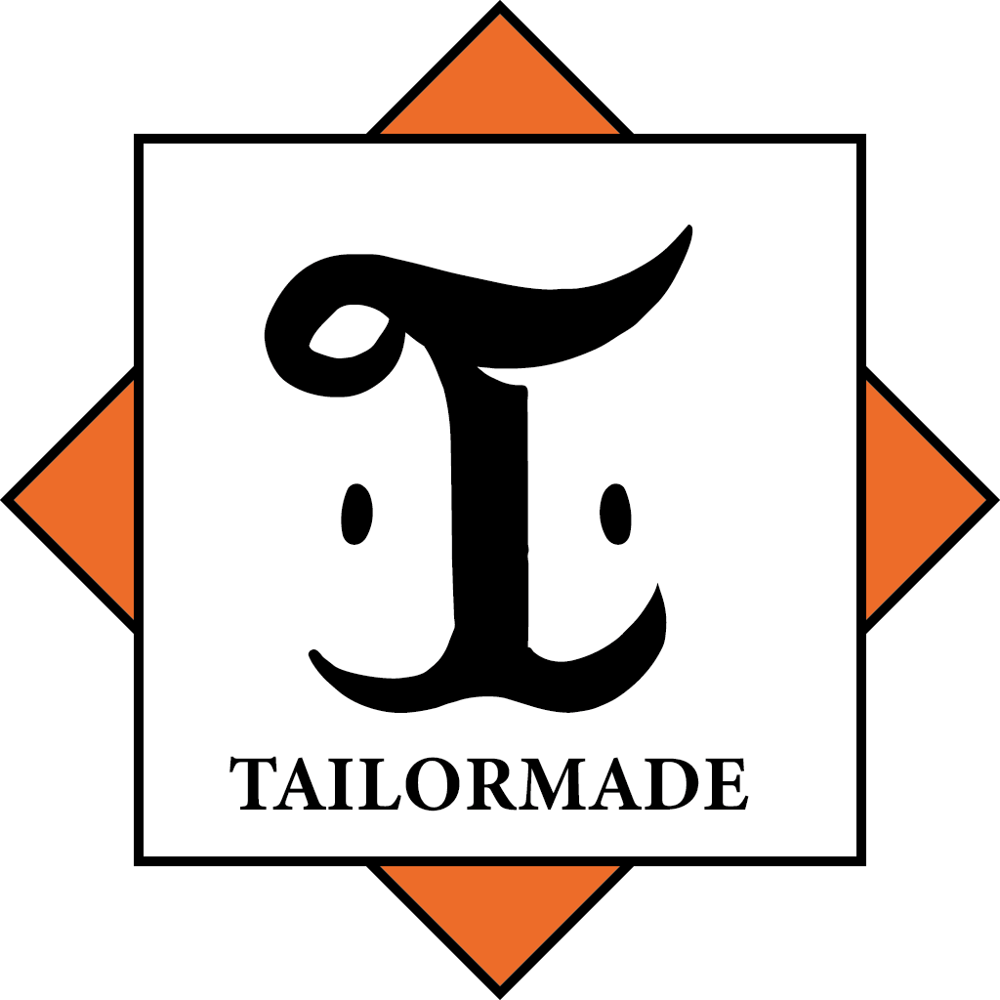

<p align="center"></p>
<h1 align="center">Tailormade<br></h1>

<p align="center">
  <strong>An in-game clothing customization mod for Minecraft.</strong><br>
  Design original armor skins pixel-by-pixel right inside the game!
</p>

<p align="center">
  <a href="https://github.com/igucheese/tailormade-atelier/releases"></a>
  <a href="https://github.com/igucheese/tailormade-atelier/blob/main/LICENSE"></a>
  <a href="https://curseforge.com/minecraft/mc-mods/tailormade"></a>
  <a href="https://modrinth.com/mod/tailormade"></a>
</p>

<p><strong>Notice</strong>: Any bug reports and suggestions to improve the mod are always welcome!</p>
<p>[Wiki](https://github.com/igucheese/tailormade-atelier/wiki) / [Issue Tracker](https://github.com/igucheese/tailormade-atelier/issues)</p>

## Overview

**Tailormade** allows players to replace the visual appearance of their armor with custom pixel art created via in-game editors, while strictly preserving its original stats, perks, and enchantments.

- **Multi-Loader Support**: Built using Architectury API for seamless NeoForge and Fabric compatibility.
- **In-Game Editor**: Features layer management (up to 8 layers), selection tool, line drawing, and custom color palettes.
- **NBT Pattern Sharing**: Export/Import pattern designs as NBT files to share with other players.
- **Visual Display**: Showcasing features via Mannequins, Showcases, and Catalogs.
---

##  Requirements & Dependencies

- **Minecraft**: 1.21.1
- **Java**: 21+
- **Mod Loaders**: NeoForge / Fabric
- **Required Dependency**: [Architectury API](https://curseforge.com/minecraft/mc-mods/architectury-api)

### Confirmed Compatibility
Tested and confirmed working with:
- **Shaders / Rendering**: Sodium, Lithium, Iris, EMF (Entity Model Features), ETF (Entity Texture Features)
- **Utilities**: Cosmetic Armor Reworked, Mod Menu

---

## Building from Source

To clone and build Tailormade locally, run the following commands:

```bash
git clone https://github.com/igucheese/tailormade-atelier.git
cd tailormade-atelier
./gradlew build
```

### NeoForge Run
```bash
./gradlew neoforge:runClient
```

### Fabric Run
```bash
./gradlew fabric:runClient
```
